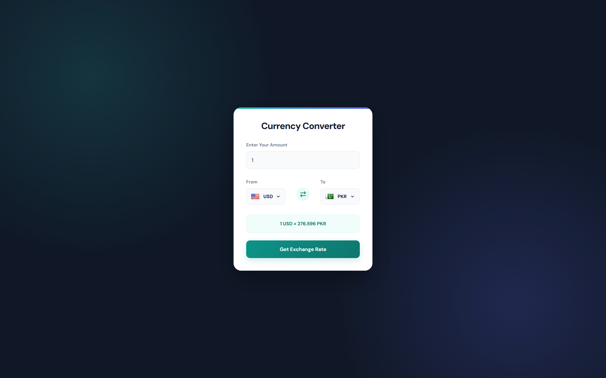
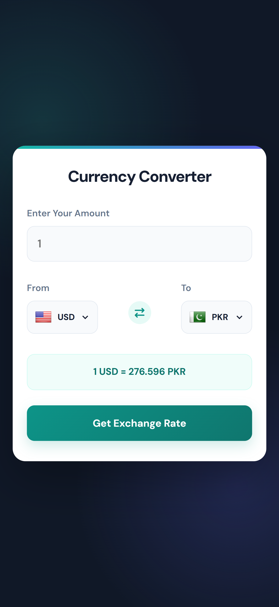

# Currency Converter

A clean, responsive currency converter built with HTML, CSS and vanilla JavaScript. Convert between 150+ currencies using live exchange rates.

🔗 **Live Demo:** [awesomised.github.io/Currency-Converter](https://awesomised.github.io/Currency-Converter/)

## Screenshots

| Desktop | Mobile |
| ------- | ------ |
|  |  |

## Features

- Live exchange rates with automatic fallback API
- Currency dropdowns with country flags
- Swap currencies with one click
- Works with decimal amounts
- Loading and error messages
- Fully responsive design

## Tech Stack

- HTML5
- CSS3
- JavaScript (ES6+)
- [Currency API](https://github.com/fawazahmed0/exchange-api) for exchange rates
- [Flags API](https://flagsapi.com/) for country flags
- [Font Awesome](https://fontawesome.com/) for icons

## Getting Started

1. Clone the repository
   ```bash
   git clone https://github.com/awesomised/Currency-Converter.git
   ```
2. Open the project folder
   ```bash
   cd Currency-Converter
   ```
3. Open `index.html` in your browser (or use the Live Server extension in VS Code).

## Author

**Kashif Altaf**
- GitHub: [@awesomised](https://github.com/awesomised)
